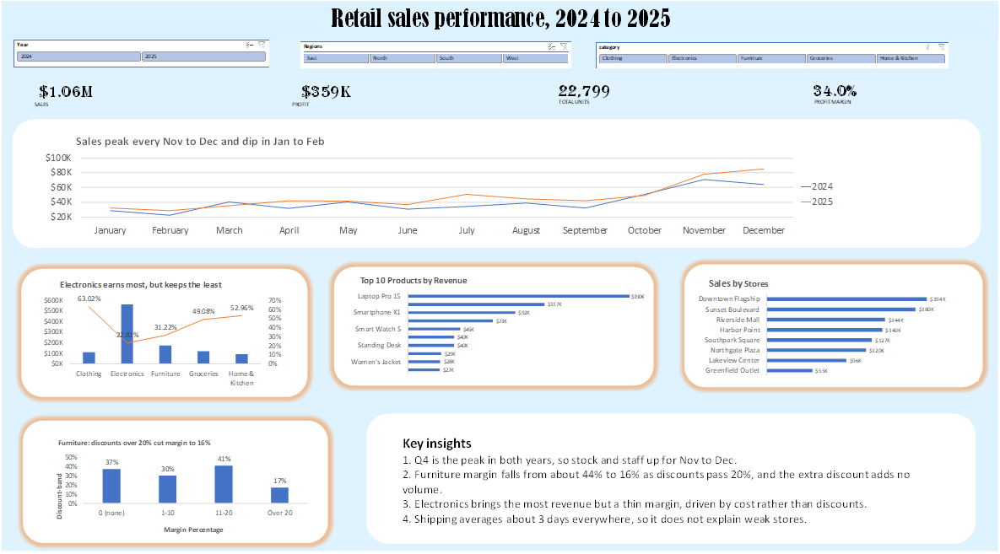

# Retail Sales Analysis | Excel & MySQL

An end-to-end retail sales analysis covering two years of sales data (2024–2025). This project focuses on data cleaning, SQL analysis, business insights, and interactive dashboard development using Excel and MySQL.

## Dashboard Preview



## Project Overview

A retail chain operating 8 stores across 4 regions needed to understand its sales performance, profitability, customer behavior, and discount impact.

The objective was to identify business trends, investigate profitability, and provide actionable recommendations using data.

## Dataset

A synthetic retail dataset created for analytical practice, consisting of four related tables:

- **Sales:** Approximately 9,950 order lines covering 2024–2025.
- **Products:** 41 products across 5 categories.
- **Customers:** 1,200 customers across 3 segments.
- **Stores:** 8 stores across 4 regions.

## Tools Used

- **Microsoft Excel 2021:** Data cleaning, PivotTables, charts, and interactive dashboard.
- **MySQL:** Database design, data validation, joins, aggregations, and business analysis.

## Project Process

1. **Data Cleaning (Excel):** Removed duplicates, corrected inconsistent values, standardized payment methods, and fixed date formats.
2. **Database Design (MySQL):** Created a relational database with four tables, primary keys, and foreign keys. Performed data validation and corrected additional data quality issues.
3. **SQL Analysis:** Investigated revenue, profit, product performance, customer behavior, store performance, seasonality, shipping, and discounts.
4. **Dashboard Development (Excel):** Built an interactive dashboard with KPI cards, PivotCharts, calculated fields, and year and region slicers.

## Dashboard

PivotTables, calculated margin fields, slicers linked across all charts, and KPI cards.

## Key Findings
**Overall:** $1.06M revenue, $359K profit, 34.0% margin, 22,799 units sold. 2025 outperformed 2024.

**Seasonality:** Sales peak every November and December and dip in January and February, in both years.

**Products:** Laptop Pro 15 is the top earner by revenue and profit but has the thinnest margin (about 16%). Coffee Beans 1kg is the best seller by units.

**Categories:**

- Electronics: highest revenue, weakest margin (about 23%), driven by product costs
- Furniture: margin hurt by heavy discounts (about 20% on average)
- Clothing and Home and Kitchen: lowest revenue but strongest margins (about 63% and 53%)

**Stores and regions:** Downtown Flagship (East) is the top store and Greenfield Outlet (South) the weakest. Margins are similar across regions, and Lakeview Center is the only store with declining revenue.

**Shipping:** Averages about 3 days with no meaningful difference by store, region, or month, so shipping does not explain weak stores.

**Discounts:** Within each category, larger discounts did not bring more units sold. In Furniture, margin falls from about 44% with no discount to about 16% above 20%.

## Business Recommendations

- Introduce discount controls, starting with Furniture.
- Protect margin on high-value Electronics, especially laptops.
- Promote Clothing and Home and Kitchen, which have strong margins and room to grow.
- Plan stock and staffing around the November to December peak.
- Investigate the declining Lakeview Center and the low-revenue Greenfield Outlet.
- Review customer discounts by segment and product mix before changing them.

## Repository Structure

```text
Retail-Sales-Analysis/
│
├── Data and Excel/
│   └── Retail_sales_analysis.xlsx
│
├── Documentation/
│   ├── Analysis_Methodology.md
│   ├── Dashboard_summary.md
│   ├── Data_Cleaning.md
│   ├── Data_Dictionary.md
│   ├── Findings.md
│   └── Project_Overview.md
│
├── SQL/
│   └── Retail_SalesAnalysis.sql
│
├── images/
│   └── Retail_sales_analysis_dashboard.png
│
└── README.md
```

## Contact

**Ezekiel Awajionyi Ogwuokwa**

007giftezekiel@gmail.com

